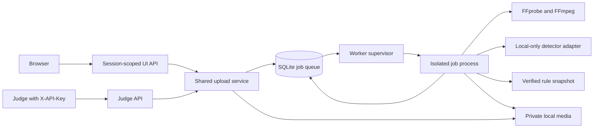

# Architecture

The React application and FastAPI API share one origin in a built deployment. The Vite development server proxies `/api` to the local API. The browser uses an anonymous HttpOnly session cookie and a separate CSRF header; it never receives the judge API key.

SQLite persists accepted jobs before acknowledgement. Claiming uses a database transaction. Worker heartbeats, job deadlines, and recovery retain a truthful state across process restarts. The deadline starts at acceptance, including time in the queue. A supervisor terminates processing and child tools when the budget expires. Queue/storage limits reject overload. The initial deployment uses one worker supervisor; concurrency is configurable and bounded.

The media pipeline probes the container, decodes locally, uses presentation timestamps, samples chronological windows, validates detector output, maps only verified rule IDs, extracts actual JPEG evidence, and generates an audio-free MP4 preview. An event's rule source text is stored with the job so later registry edits cannot silently change prior findings. The judge response is derived from that same result with JPEG base64; UI responses carry authenticated media URLs and richer explanations.

The detector interface separates model integration from HTTP and the UI. `UnconfiguredDetector` never reports ready. `OllamaLocalDetector` supports images and schema-constrained output, with no tools, model pulls, external searches, redirects, or cloud fallback. Deterministic code resolves frame IDs to timestamps and rules to source references. Model observations and footage are untrusted data.

Synthetic demo fixtures have separate routes and storage. Demo enablement does not change real readiness. Demo data cannot enter the judge job namespace. There are no employee accounts, identity scores, banking transactions, or disciplinary decisions.

## Extension points

- Colors and radii: `frontend/src/styles/theme.css`.
- Interface wording: `frontend/src/locales/`.
- New detector: implement the adapter contract in `backend/app/detectors/`, then add an explicit factory selection and tests. Keep frame/rule validation in deterministic services.
- New rule: add a schema-valid record to `config/rules.json` after source/context verification. See `RULES.md`.
- New workflow: add a service and API contract, then presentation components. Preserve authorization and job ownership for every media route.

No real detector accuracy or viewpoint robustness has been established. Sampling can miss brief events, and local models can misinterpret actions. Human inspection remains required. Independently hosted inference processes need their own memory/concurrency bounds and cancellation verification; the worker cannot forcibly terminate a separate service's GPU computation through HTTP alone.
